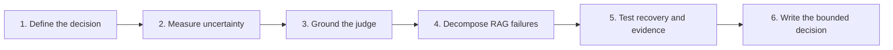

# AI Evaluation Engineer Learning Path

This is the project-based route for learning evaluation engineering. An
evaluation is a measurement designed to support a decision; it is not just a
score or a test command.

## Stage 1 — Define the decision

Use the design guides to write the decision, failure cost, unit of analysis,
required evidence, negative control, and limitation.

Interview question: **What would you do differently if the score were wrong?**

## Stage 2 — Measure uncertainty

Run the [Eval Statistics Interview Lab](https://github.com/julie-elkins/llm-eval-validity/blob/main/docs/eval-statistics-interview-lab.md).

Practice paired bootstrap, McNemar's test, cluster bootstrap, multiple comparisons,
confidence intervals, PR-AUC versus ROC-AUC, pass@k, pass^k, and cost per solved task.

Interview question: **Are these observations independent, paired, or clustered, and
what changes if that assumption is wrong?**

## Stage 3 — Ground the judge

Read the [Human-Grounded Judge Calibration Study](https://github.com/julie-elkins/llm-eval-validity/blob/main/research/response-quality/CALIBRATION_STUDY.md).

Separate human-human agreement, judge-human agreement, judge repeatability,
rubric redundancy, position and verbosity bias, abstention, screening suitability,
and release-gate suitability.

Interview question: **What evidence would make you trust a judge enough to screen
cases, and what additional evidence would be required before it could approve a release?**

## Stage 4 — Decompose RAG failures

Run the [RAG Failure-Decomposition Lab](https://github.com/julie-elkins/claude-evaluation-lab/tree/main/labs/optional-rag-failure-decomposition).

RAG means retrieval-augmented generation: the system retrieves source material
before generating an answer. Measure retrieval recall, ranking, context assembly,
grounding, citations, stale sources, conflicting sources, answerability, and the
retrieval-versus-generation ablation separately.

Interview question: **Did the system fail to find the evidence, fail to use the
evidence, or cite evidence that did not support the claim?**

## Stage 5 — Test recovery and evidence

Use [ESAC-Bench](https://github.com/julie-elkins/esac-bench) to evaluate recovery,
claim support, and evidence completeness. Recovery means the system resumes or
hands off without silently changing what counts as success.

Interview question: **What survives interruption, retry, or handoff, and what
artifact supports the completion claim afterward?**

## Stage 6 — Produce the capstone

Create one bounded evaluation report containing:

1. decision and failure cost;
2. task and evidence contracts;
3. baseline and candidate results;
4. uncertainty and dependence assumptions;
5. judge calibration evidence;
6. retrieval or agent failure decomposition;
7. recovery and evidence results;
8. known negative controls;
9. cost and operational limits; and
10. release, hold, revise, rollback, or escalate recommendation.

The capstone is not a score dump. It is a decision record: a short explanation
of what the evidence supports and what remains unresolved.

## Learner safety boundary

The required path is offline or synthetic. Do not add credentials, private prompts,
raw provider payloads, unpublished exam content, or private learner data to the
public repositories. Live-provider work is optional, bounded, and must be approved
separately.

## What completing this path proves

It demonstrates that a learner can design, run, interpret, and communicate a bounded
evaluation using explicit evidence and limitations.

## What it does not prove

It does not certify a learner, a model, an agent, a provider, or a production system.
Production approval requires workload-specific evidence, ownership, security review,
operational controls, and human accountability.
