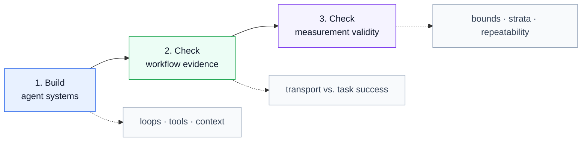

# Agent Evaluation Learning Path

A hands-on path from building agent systems to evaluating whether they are trustworthy.

This is a learner portal, not a fourth course. It connects three public repositories.
Each linked repository remains the canonical source of truth—the authoritative location
for the lessons, code, fixtures, and analysis it owns.

**Path:** 🟦 Build the system → 🟩 Check the workflow → 🟪 Check the measurement

## Learning path at a glance



The colors are navigation cues, not maturity ratings: blue means build, green means
check the workflow, and purple means check the measurement.

## Start here

This path is for developers, technical enablement practitioners, evaluators, and builders
who want to understand how to build an agent workflow, test its failure boundaries, and
decide whether an evaluation supports a real decision.

You need:

- a terminal;
- basic Python and Markdown familiarity;
- `uv`, the Python environment and package runner used by these projects; and
- no API credentials for the required path.

The required exercises are offline or synthetic. The optional judge stage in Part 3 is
the only step that can spend money, and it is not required.

Follow the parts in order.

## Part 1 — Build the system

**Repository:** [Claude Architect Lab](https://github.com/julie-elkins/claude-architect-lab)

**Objective:** Understand how agentic loops, tools, MCP (Model Context Protocol),
configuration, structured output, context management, and human escalation fit together
in one working system.

**Start:**

1. Read the [three-part learning path](https://github.com/julie-elkins/claude-architect-lab/blob/main/LEARNING-PATH.md).
2. Read the [whole-course guide](https://github.com/julie-elkins/claude-architect-lab/blob/main/GUIDE.md)
   from top to bottom. It contains the 29 lessons in dependency order.
3. Run the local Course Doctor lab:

```bash
uv venv --python 3.12
uv pip install -e '.[test]'
./scripts/run-tests.sh
```

**Expected result:** The course test script completes with all tests passing and no
skipped tests. The Course Doctor lab demonstrates that cited material, verified material,
and material requiring human review are different states.

**Learner checkpoint:** Explain why a citation is not the same thing as verification,
what the Course Doctor refuses to claim when it cannot fetch or match evidence, and why
the lesson files are edited while `GUIDE.md` is generated.

**Limitation:** Completing this course does not grant a certification or predict an exam
score.

## Part 2 — Check the workflow

**Repository:** [Agent Assurance Harness](https://github.com/julie-elkins/agent-assurance-harness)

**Objective:** Learn to distinguish transport success from task success and require
evidence before an agent reports completion.

**Start:** Open the
[Agent Workflow Teaching Lab](https://github.com/julie-elkins/agent-assurance-harness/blob/main/examples/agent-workflow-teaching-lab/README.md)
and run this from the repository root:

```bash
uv run python examples/agent-workflow-teaching-lab/run_lab.py
```

**Expected result:**

- the naive path is `failed`;
- the guarded path is `completed`;
- both paths report transport status `ok`;
- the naive path retries three times and exceeds its synthetic ceilings; and
- the guarded path records a semantic outcome and escalates for human approval.

**Learner checkpoint:** Explain why an HTTP-success response is not enough to prove task
success, what retry and cost ceilings protect against, and why the breaker must be
independent of the component it evaluates.

**Limitation:** This is an offline synthetic control. It does not establish live model
quality, production monitoring, or business impact.

## Part 3 — Check the measurement

**Repository:** [LLM Eval Validity](https://github.com/julie-elkins/llm-eval-validity)

**Objective:** Learn to ask whether an evaluation measures what it claims to measure,
rather than accepting a green pass rate as sufficient evidence.

**Start:** Open the repository and run:

```bash
make analyse
```

This runs the offline analyses only. Do not run `make judge` for this path; that is the
optional model-judge stage and can incur provider cost.

**Expected result:** The analyses complete from the checked-in fixture without network
access or credentials. The reports show why sample size, stratification, confidence
bounds, rater agreement, and evaluator repeatability can change a deployment decision.

**Learner checkpoint:** Explain why a point estimate can look safe while its confidence
bound is not, why pooled results can hide a high-consequence failure family, and why an
evaluation needs evidence about its own repeatability.

**Limitation:** This study uses a fixed historical fixture and one human reference pass.
It demonstrates evaluation reasoning; it does not establish general model quality or
production safety.

## Completion check

You have completed the path when you can:

1. describe the agent workflow you would build;
2. identify evidence that would make the workflow abstain or escalate;
3. explain why the evaluation method itself may be too weak to support the decision; and
4. state what each repository does not prove.

## More learning

For additional technical walkthroughs and enablement material, visit
[AWS Julie on YouTube](https://www.youtube.com/@JulieElkins). The channel is
supplementary learning; the three repositories remain the evidence for this path's
exercises and claims.

## Repository boundaries

The three linked repositories remain separate and continue to own their own material.
This portal contains navigation and learner expectations only. It intentionally does not
copy lessons, code, fixtures, or analysis, so updates remain in one authoritative place.

If a link or command becomes outdated, update this portal's README; do not duplicate the
underlying course content here.
