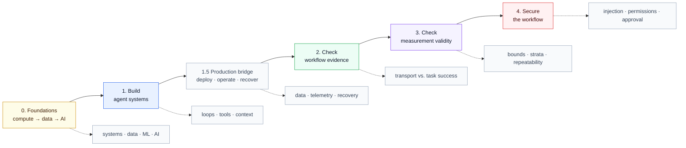

# Agent Evaluation Learning Path

A hands-on path from understanding AI fundamentals to building, evaluating, and securing
agent systems.

This is a learner portal, not a fourth course. It has five stages, one production
bridge, and connects three
public repositories. Each linked repository remains the canonical source of truth—the
authoritative location for the lessons, code, fixtures, and analysis it owns.

**Path:** 🟨 Foundations → 🟦 Build → 🟧 Production bridge → 🟩 Check the workflow → 🟪 Check the measurement → 🟥 Secure

## Learning path at a glance



The colors are navigation cues, not maturity ratings: yellow means foundations, blue
means build, green means check the workflow, purple means check the measurement, and red
means secure the workflow.

## Start here

This path is for developers, technical enablement practitioners, evaluators, and builders
who want to understand how to build an agent workflow, test its failure boundaries, and
decide whether an evaluation supports a real decision.

You need:

- a terminal;
- basic Python and Markdown familiarity;
- `uv`, the Python environment and package runner used by these projects; and
- no API credentials for the required path.

The required exercises are offline or synthetic. The optional judge stage in Part 3 is
the only step that can spend money, and it is not required.

Follow the parts in order.

### New learner: the shortest route

If you are new to AI systems, use this sequence:

1. Read Part 0's **Minimum path** and trace the synthetic request shown there.
2. Open the [Claude Architect Lab learning path](https://github.com/julie-elkins/claude-architect-lab/blob/main/LEARNING-PATH.md),
   then use its [whole-course guide](https://github.com/julie-elkins/claude-architect-lab/blob/main/GUIDE.md)
   as the single reading path.
3. Run the Course Doctor check from Part 1.
4. Run the [Production AI Engineering Bridge Lab](https://github.com/julie-elkins/agent-assurance-harness/blob/main/examples/production-ai-engineering-bridge-lab/README.md).
5. Continue to workflow evidence, measurement validity, and security.

You do not need to understand the repository folders before starting. The portal gives
you the route; each repository remains the authoritative source for the material it
owns.

## Part 0 — Build the foundations

**Objective:** Build the technical layers underneath AI systems before choosing
frameworks or writing agent code.

AI is not a single layer. A useful learner map is:

1. **Computing and systems:** operating systems, processes, memory, storage,
   virtualization (isolated computing environments), and containers.
2. **Networking and distributed systems:** DNS, HTTP, TLS, APIs, latency, retries,
   queues, identity, and failure across service boundaries.
3. **Cloud and operations:** shared responsibility, isolation, observability, cost,
   backup, rollback, and recovery.
4. **Data engineering:** schemas, storage, pipelines, data quality, lineage, access
   control, and reproducibility.
5. **Statistics and machine learning:** train/test splits, leakage, overfitting,
   uncertainty, metrics, and error analysis.
6. **AI and model systems:** search, planning, neural networks, embeddings,
   transformers, retrieval, and generation.
7. **Agent assurance:** context, tools, evaluation, security boundaries, approval, and
   incident response.

Data engineering is foundational to production machine learning. Machine learning is a
major foundation of modern applied AI, but not the whole of AI: search, planning, and
symbolic reasoning also matter.

**Minimum path:** Study systems, networking, data, ML, and AI vocabulary before Part 1.

**Depth branches:** HPC (high-performance computing, parallel compute for large-scale
training and inference), GPUs and accelerators, distributed training, cloud operations,
security, and evaluation can be studied alongside or after the first lab.

**Start with existing learning material:**

1. Watch the [AWS Fundamentals playlist](https://www.youtube.com/playlist?list=PLP_7utpX7Z569VCiEQvUDGZyMio6dnsM8)
   for cloud and shared-responsibility basics.
2. Use the [Networking Fundamentals — AWS course](https://www.youtube.com/playlist?list=PLP_7utpX7Z55Ln61iRVtDqXM_UGmRgTkS)
   for the network path behind clients, services, and tools.
3. Browse [Brain Bites: AI Engineering](https://www.youtube.com/playlist?list=PLBejoz8Hp_sE)
   for short AI engineering examples.

**Vocabulary to learn:** model, prompt, context, tool, workflow, agent, eval
(evaluation), guardrail (a protective check that restricts model or tool behavior), and
human approval.

**Learner exercise:** Trace one synthetic request through this sequence:

```text
request → model → context → tool → result → evidence → completion or escalation
```

**Expected result:** You can explain how a request moves through the systems, network,
data, ML, and AI layers, then identify where an apparently successful response could
still fail.

**Learner checkpoint:** Explain the difference between a chatbot, a workflow, and an
agent; why adding a tool increases both capability and risk; and why data quality,
network behavior, and resource limits can become AI failures.

**Limitation:** These materials provide foundations; they do not replace hands-on
implementation or prove that a particular model is safe or accurate.

## Part 1 — Build the system

**Repository:** [Claude Architect Lab](https://github.com/julie-elkins/claude-architect-lab)

**Objective:** Understand how agentic loops, tools, MCP (Model Context Protocol),
configuration, structured output, context management, and human escalation fit together
in one working system.

**Start:**

1. Read the [three-part learning path](https://github.com/julie-elkins/claude-architect-lab/blob/main/LEARNING-PATH.md).
2. Read the [whole-course guide](https://github.com/julie-elkins/claude-architect-lab/blob/main/GUIDE.md)
   from top to bottom. It contains the 29 lessons in dependency order.
3. Run the local Course Doctor lab:

```bash
uv venv --python 3.12
uv pip install -e '.[test]'
./scripts/run-tests.sh
```

**Expected result:** The course test script completes with all tests passing and no
skipped tests. The Course Doctor lab demonstrates that cited material, verified material,
and material requiring human review are different states.

**Learner checkpoint:** Explain why a citation is not the same thing as verification,
what the Course Doctor refuses to claim when it cannot fetch or match evidence, and why
the lesson files are edited while `GUIDE.md` is generated.

**Limitation:** Completing this course does not grant a certification or predict an exam
score.

## Production bridge — Deploy and operate the system

**Objective:** Connect a locally working agent workflow to the operational controls
needed to observe, evaluate, contain, and recover it. **LLMOps** means the operational
practices for monitoring, evaluating, versioning, cost-controlling, and recovering
large-language-model systems.

**Read:** [Production AI Engineering Bridge](https://github.com/julie-elkins/agent-assurance-harness/blob/main/docs/PRODUCTION_AI_ENGINEERING_BRIDGE.md)

**Run:** Open the
[Production AI Engineering Bridge Lab](https://github.com/julie-elkins/agent-assurance-harness/blob/main/examples/production-ai-engineering-bridge-lab/README.md)
and run:

```bash
uv run python examples/production-ai-engineering-bridge-lab/run_lab.py
```

**Expected result:** The synthetic workflow records its data contract and access check,
detects an empty semantic result despite transport success, blocks an external write
without execution authority, preserves bounded evidence, contains the incident, and
stages recovery for human review. It also reports bounded synthetic retry, cost, and
latency controls rather than implying that a successful run is automatically ready for
production.

**Learner checkpoint:** Explain what evidence would reconstruct the run, why the
external action is blocked, which boundary is outside the model, and what regression
test should run before recovery. Identify which guardrails apply at input, agent,
handoff, tool, and external-action boundaries, and explain what happens if the
guardrail or approval check is unavailable.

**Advanced continuation:** Read the
[Advanced Production Operations lesson](https://github.com/julie-elkins/agent-assurance-harness/blob/main/docs/ADVANCED_PRODUCTION_OPERATIONS.md)
to study the organizational decisions around an incident. Assign an incident
commander, technical lead, security/privacy lead, product owner, communications lead,
scribe, and change approver. Then return to the
[AI Incident Response Tabletop Lab](https://github.com/julie-elkins/agent-assurance-harness/blob/main/examples/ai-incident-response-lab/README.md)
and decide who owns containment, what the first bounded update says, whether recovery
is a standard or emergency change, what canary scope is safe, and what evidence permits
broader restoration.

**Limitation:** This is an offline synthetic lab. It does not establish live model
quality, production observability, security approval, rollback capability, or business
impact.

## Part 2 — Check the workflow

**Repository:** [Agent Assurance Harness](https://github.com/julie-elkins/agent-assurance-harness)

**Objective:** Learn to distinguish transport success from task success and require
evidence before an agent reports completion.

**Start:** Open the
[Agent Workflow Teaching Lab](https://github.com/julie-elkins/agent-assurance-harness/blob/main/examples/agent-workflow-teaching-lab/README.md)
and run this from the repository root:

```bash
uv run python examples/agent-workflow-teaching-lab/run_lab.py
```

**Expected result:**

- the naive path is `failed`;
- the guarded path is `completed`;
- both paths report transport status `ok`;
- the naive path retries three times and exceeds its synthetic ceilings; and
- the guarded path records a semantic outcome and escalates for human approval.

**Learner checkpoint:** Explain why an HTTP-success response is not enough to prove task
success, what retry and cost ceilings protect against, and why the breaker must be
independent of the component it evaluates.

**Limitation:** This is an offline synthetic control. It does not establish live model
quality, production monitoring, or business impact.

## Part 3 — Check the measurement

**Repository:** [LLM Eval Validity](https://github.com/julie-elkins/llm-eval-validity)

**Objective:** Learn to ask whether an evaluation measures what it claims to measure,
rather than accepting a green pass rate as sufficient evidence.

**Start:** Open the repository and run:

```bash
make analyse
```

This runs the offline analyses only. Do not run `make judge` for this path; that is the
optional model-judge stage and can incur provider cost.

**Expected result:** The analyses complete from the checked-in fixture without network
access or credentials. The reports show why sample size, stratification, confidence
bounds, rater agreement, and evaluator repeatability can change a deployment decision.

**Learner checkpoint:** Explain why a point estimate can look safe while its confidence
bound is not, why pooled results can hide a high-consequence failure family, and why an
evaluation needs evidence about its own repeatability.

**Limitation:** This study uses a fixed historical fixture and one human reference pass.
It demonstrates evaluation reasoning; it does not establish general model quality or
production safety.

## Part 4 — Secure the workflow

**Repository:** [Agent Assurance Harness](https://github.com/julie-elkins/agent-assurance-harness)

**Objective:** Identify how untrusted content, excessive permissions, unsafe tool use,
and missing approval boundaries can turn a capable AI workflow into a security problem.

**Security prerequisites:**

- [AWS Security Group Essentials](https://www.youtube.com/watch?v=JrZO80qMRWc)
- [AWS Security Specialty exam tips](https://www.youtube.com/watch?v=c1Jkg4RcEVw)

These videos provide cloud and network security context. They are prerequisites, not
AI-agent security training.

**Read current first-party guidance:**

- [OpenAI Agent Builder safety](https://developers.openai.com/api/docs/guides/agent-builder-safety)
- [OpenAI deep research safety](https://developers.openai.com/api/docs/guides/deep-research)
- [Anthropic trustworthy agents](https://www.anthropic.com/research/trustworthy-agents)
- [Anthropic Claude Code sandboxing](https://www.anthropic.com/research/claude-code-sandboxing)

**Learner exercise:** Create a threat model—a map of assets, trust boundaries, and
attacker paths—for a synthetic agent that reads a document and can call a tool.

Identify:

- where prompt injection could enter;
- which content is untrusted;
- which tool permissions are broader than necessary;
- where data could be exfiltrated; and
- which action requires human approval;
- whether every agent handoff and tool boundary has the required guardrail;
- what happens if a guardrail, approval service, or telemetry path is unavailable; and
- what data should be retained, deleted, or shown to a reviewer.

**Expected result:** You can describe a guarded path that validates tool arguments and
outputs, limits access, records the decision, blocks unsafe actions, fails closed when
the required control is unavailable, and escalates when evidence is insufficient. You
can also state how the workflow protects privacy and makes AI-influenced decisions
visible to the appropriate reviewer.

**Learner checkpoint:** Explain why a model's ability to follow instructions is also a
security risk when the instructions come from an untrusted document, webpage, email, or
tool result.

**Continue with the AI incident-response guide:**

- Read the [AI Incident Response Guide](https://github.com/julie-elkins/agent-assurance-harness/blob/main/docs/AI_INCIDENT_RESPONSE.md).
- Run the [AI Incident Response Tabletop Lab](https://github.com/julie-elkins/agent-assurance-harness/blob/main/examples/ai-incident-response-lab/README.md).
- Read [Developer Workflow Assurance](https://github.com/julie-elkins/agent-assurance-harness/blob/main/docs/DEVELOPER_WORKFLOW_ASSURANCE.md)
  to examine the delivery path—the code, dependencies, permissions, and CI checks that
  enforce the security controls.

The guide preserves the familiar preparation, identification, containment,
investigation, eradication, recovery, and follow-up lifecycle, then adds AI-specific
questions about model revisions, context, tools, execution authority, retries, and
evidence preservation.

**Limitation:** The current portal exercise is tool-agnostic and synthetic. The
tabletop lab is also synthetic. No real secrets, external destinations, or production
telemetry belong in the exercise.

## Completion check

You have completed the path when you can:

1. explain the foundational components of an AI system;
2. describe the agent workflow you would build;
3. explain how data, access, telemetry, evaluation, and recovery connect in a
   production-shaped workflow;
4. identify evidence that would make the workflow abstain or escalate;
5. explain why the evaluation method itself may be too weak to support the decision;
6. identify untrusted inputs, excessive permissions, and approval boundaries; and
7. identify where guardrail coverage, privacy, transparency, and delivery-path evidence
   can fail; and
8. state what each repository does not prove.

## More learning

For additional technical walkthroughs and enablement material, visit
[Julie Elkins on YouTube](https://www.youtube.com/@JulieElkins). The channel is
supplementary learning; the three repositories remain the evidence for this path's
exercises and claims.

## Repository boundaries

The three linked repositories remain separate and continue to own their own material.
This portal contains navigation and learner expectations only. It intentionally does not
copy lessons, code, fixtures, or analysis, so updates remain in one authoritative place.
Part 4's future executable security lab will belong in the Agent Assurance Harness, not
in this portal.

If a link or command becomes outdated, update this portal's README; do not duplicate the
underlying course content here.
